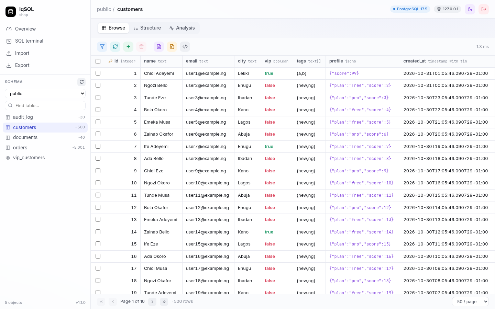

# LiteSQL

A small web admin for **one** PostgreSQL (incl. pgvector), MySQL/MariaDB or SQLite database.
It is meant to replace pgAdmin / phpMyAdmin on a small VPS: one Python process with no workers, using **~60–75 MB RAM**.



## Features
- **Browse**: lists schemas and tables with row counts and sizes. Tables are paginated, and you can sort and filter (=, ≠, >, <, contains, starts with, is null, in…). The app knows each table's primary key.
- **Edit**: double-click a cell to edit it. You can also insert a row (value, DEFAULT or NULL per column) or delete selected rows after a confirm. Every edit uses parameterized SQL. Tables without a PK still work: PG uses `ctid` and SQLite uses `rowid`.
- **SQL terminal**: runs several statements in one transaction and shows timing and affected rows for each. Destructive SQL asks for confirmation first (DROP/TRUNCATE/DELETE or UPDATE without WHERE). It keeps a history, can run just the selection, and exports results as CSV.
- **Export**: a SQL dump (DDL, data, sequences, indexes, FKs, views, triggers, extensions) or a CSV of a table with its current filter and sort.
- **Import**:
  - **CSV**: preview, column mapping, append to an existing table or create a new typed one. It runs in a single transaction.
  - **.sql file**: shows progress and stops on error. It runs in a single transaction where the engine allows it.
- **Analysis**:
  - Database size, cache hit rate and connections.
  - Tables by size, unused indexes, and FKs with no index.
  - Missing PKs, dead rows, and pg extensions (pgvector columns).
  - Per table: null rate and distinct counts per column, duplicate-PK check, indexes with scan counts, and relationships.
- **Interface**: light and dark themes, sized for laptop screens. `READ_ONLY=true` turns it into a safe viewer.

## Environment
| Var | Required | Default | Notes |
|---|---|---|---|
| `DATABASE_URL` | ✔ | – | `postgres://u:p@host:5432/db`, `mysql://u:p@host:3306/db`, `sqlite:////data/app.db` |
| `ADMIN_USER` | ✔ | – | single admin login |
| `ADMIN_PASSWORD` | ✔ | – | ≥ 8 chars; never logged |
| `SQL_TYPE` | | inferred | `postgresql` · `mysql` · `sqlite` |
| `APP_URL` | | – | public URL; `https://` enables Secure cookies |
| `READ_ONLY` | | `false` | blocks edits, imports and writing SQL |
| `IMPORT_MAX_MB` | | `25` | upload cap for CSV / .sql |
| `QUERY_TIMEOUT_SECONDS` | | `30` | per statement (PG `statement_timeout`, MySQL `max_execution_time`, SQLite deadline) |
| `PAGE_SIZE_DEFAULT` | | `50` | rows per page |
| `SECRET_KEY` | | derived | cookie signing key (derived from the admin credentials if unset) |
| `MAX_RESULT_ROWS` | | `1000` | rows shown per terminal result |
| `SESSION_HOURS` | | `12` | login lifetime |
| `PORT` | | `80` | container listen port (leave unset on Coolify) |
| `ROOT_PATH` | | empty | serve under a path, e.g. `/litesql`; empty = domain root |

## Deploy on Coolify
1. Push this folder to a **private** repo, or upload the zip contents. In Coolify, go to **+ New → Docker Compose** (choose a Git source, "Docker Compose" build pack, and `/docker-compose.yml`).
2. On the `litesql` service, set the **Domain** to `https://sql.collab.name.ng` with **no port**. If Coolify shows a port field, leave it empty or on auto. The container listens on port 80 inside its own network, which is Coolify's default upstream port. No host port is published, so it cannot collide with other apps already using 8080 or anything else on the VPS. Point the DNS A record for `sql.collab.name.ng` at the VPS (62.169.23.173).
3. **Environment variables**: set `DATABASE_URL`, `ADMIN_USER`, `ADMIN_PASSWORD` and `APP_URL=https://sql.collab.name.ng`. Optionally set `READ_ONLY`, `IMPORT_MAX_MB` and the others. Mark the password as a secret, and enter it in Coolify, not in the repo.
4. **Internal `DATABASE_URL` tip**: for a database that Coolify manages, copy the **Postgres URL (internal)** from the DB's page. Its host is the container name, e.g. `postgres://postgres:…@q8k2…abc:5432/postgres`. That traffic stays on the Docker network and needs no public port. For LiteSQL to resolve that hostname, tick **Connect to Predefined Network** on the LiteSQL resource, or uncomment the `coolify` external network in `docker-compose.yml`. A DB that belongs to another compose stack needs that stack's network instead (or the predefined network on both).
5. Deploy. The healthcheck hits `/api/health`, and the container is capped at `mem_limit: 256m`.

**Ports**: the app listens on `0.0.0.0:$PORT` (default `80` in the image). You only need to set `PORT` if you want a different internal port, and then you must append it to the Coolify domain (`https://sql.collab.name.ng:<PORT>`). Binding 80 as the non-root user relies on the `net.ipv4.ip_unprivileged_port_start: 0` sysctl in the compose file, which Docker 20.10+ already sets by default.

### Path mode: an existing domain at `/litesql` (optional)
Use this to put LiteSQL on a domain you already use, e.g. `https://existing.collab.name.ng/litesql`, alongside the app that serves `/`.

| Setting (Coolify) | Subdomain / root mode (default) | Path mode |
|---|---|---|
| Domain on the `litesql` service | `https://sql.collab.name.ng` | `https://existing.collab.name.ng/litesql` |
| `ROOT_PATH` | *(leave empty)* | `/litesql` |
| `APP_URL` | `https://sql.collab.name.ng` | `https://existing.collab.name.ng/litesql` |
| Port | no `:port`, auto | no `:port`, auto |

- `ROOT_PATH` is normalized, so `litesql`, `/litesql` and `/litesql/` all mean `/litesql`. `/litesql` redirects to `/litesql/`.
- LiteSQL knows its prefix, so the proxy **does not need to strip the path**:
  - **Without a strip** (Traefik `PathPrefix(`/litesql`)` forwards `/litesql/api/...`): LiteSQL removes the prefix itself.
  - **With a strip** (Traefik `stripprefix` middleware, or Coolify's "Strip Prefixes" option): LiteSQL receives `/api/...` and still works.
- The UI gets the prefix from the server through `<base href>` and `window.__ROOT_PATH__`, so assets and API calls stay under `/litesql`. The session cookie is scoped to `Path=/litesql`.
- The healthcheck automatically calls `{ROOT_PATH}/api/health`.
- Traefik gives longer rules priority, so `existing.collab.name.ng/litesql` wins over the app that owns `existing.collab.name.ng/`. No DNS change is needed.

To manage several databases, deploy one LiteSQL per database (each about 70 MB) on its own subdomain, e.g. `sql.collab.name.ng` and `mysql.collab.name.ng`.

### Plain Docker
```bash
cp .env.example .env   # edit it
docker compose up -d --build   # uncomment `ports:` → http://localhost:6789 (HOST_PORT), or put it behind your proxy
```

## Security
- There is one admin account and no sign-up. Sessions use an HMAC-signed cookie (HttpOnly, SameSite=Lax, and Secure on https). Failed logins are rate-limited.
- Every non-GET request needs the `x-litesql: 1` header, which works as a CSRF guard together with SameSite.
- Grid edits, inserts, deletes and filters are parameterized. Raw SQL is available only to the signed-in admin.
- The startup log prints the DB URL with the password masked. The admin password is never logged, and access logs are off in the container.
- `READ_ONLY=true` adds a server-side guard. Where possible it also opens read-only sessions (PG and MySQL `SET SESSION … READ ONLY`, SQLite `PRAGMA query_only`). For the strongest setup, also use a DB user that has only SELECT.
- `noindex` is set. For an extra layer you can add Coolify basic-auth or an IP allow-list.

## Local development
```bash
python -m venv .venv && .venv/bin/pip install -r requirements.txt
cd web && npm install && npx vite build && cd ..       # builds into app/static
DATABASE_URL=sqlite:///./demo.db ADMIN_USER=admin ADMIN_PASSWORD=devpassword \
  .venv/bin/uvicorn app.main:app --port 8091
# UI hot reload: cd web && npx vite  (proxies /api to :8091)
```

## Limits (v1)
- Terminal results are capped at `MAX_RESULT_ROWS`. Exports stream without that cap.
- `.sql` import runs plain statements. It does not support `COPY … FROM stdin` (pg_dump's default format), so use `pg_dump --inserts` or LiteSQL's own dumps. The upload size is capped.
- MySQL commits DDL implicitly, so a failed multi-statement batch can only roll back its DML.
- There are no ER diagrams, query plans view or user/role management, and only one database per instance.
